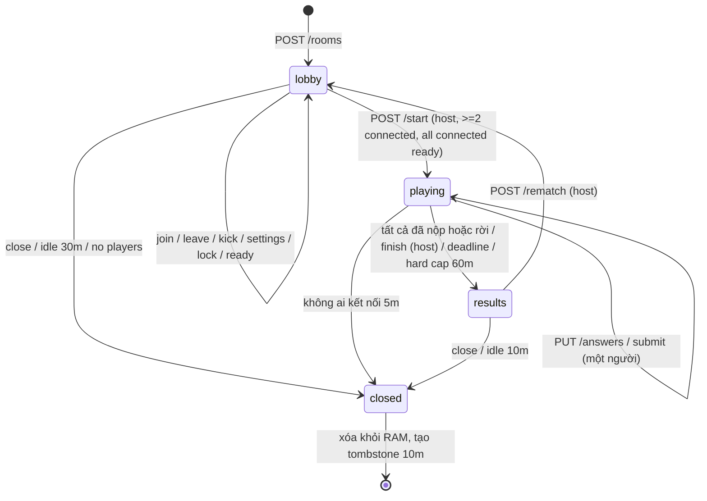
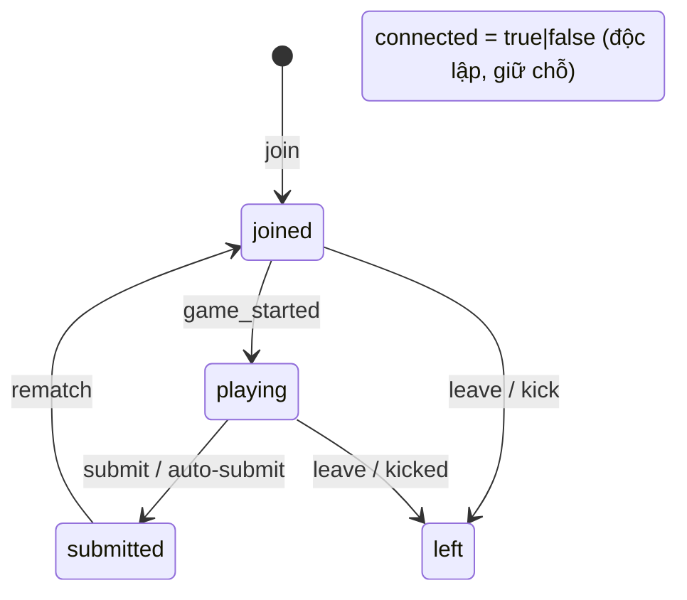

# Luyện tập nhóm — hợp đồng API và dữ liệu (phác thảo)

> **Trạng thái: thiết kế ĐÃ DUYỆT (chủ, 31/10, D1–D14 theo khuyến nghị — xem [plan §6](group-practice-plan.md#6-quyết-định-của-chủ-sở-hữu)). Lõi phòng (S1) và lớp thời gian thực/độ bền/an toàn (S2: SSE, giới hạn tốc độ, drain, healthz, CSP) nằm trong `rooms/`, tắt mặc định bằng `ROOMS_ENABLED`; chưa có UI/deploy.** Tên trường có thể chỉnh khi hiện thực. Quy tắc: [group-practice.md](group-practice.md). Lý do chọn SSE + POST, token, giới hạn: [group-practice-tech.md](group-practice-tech.md).

Quy ước: tiền tố `/rt` (Caddy chuyển tới service `rooms`); JSON UTF-8; lỗi `{ "error": { "code", "message" } }` như [architecture.md](architecture.md); xác thực người chơi bằng cookie token `HttpOnly` theo phòng ([tech §5](group-practice-tech.md#5-token-vào-lại-và-phiên)); mọi POST/PUT kiểm tra `Origin` + `Content-Type: application/json`; thân ≤ 4 KB.

## 1. Endpoint

| Method | Path | Ai gọi | Mô tả |
|--------|------|--------|-------|
| POST | `/rt/rooms` | chưa vào phòng | Tạo phòng; người tạo thành chủ phòng. Trả `code`, `me`, snapshot. Set cookie token |
| GET | `/rt/rooms/{code}/preview` | chưa vào phòng | Tóm tắt phòng để hiện ở màn "Vào phòng" (không tên người chơi): đề, số người/tối đa, `joinable` |
| POST | `/rt/rooms/{code}/join` | chưa vào phòng | `{ name }` → vào phòng chờ. Set cookie token |
| GET | `/rt/rooms/{code}/events` | đã vào | SSE: snapshot đầu + sự kiện |
| GET | `/rt/rooms/{code}/snapshot` | đã vào | Trạng thái hiện tại (dự phòng khi SSE hỏng; polling 3 s) |
| POST | `/rt/rooms/{code}/settings` | chủ phòng, `lobby` | Sửa cài đặt/đề; khóa phòng |
| POST | `/rt/rooms/{code}/kick` | chủ phòng | `{ playerId }` |
| POST | `/rt/rooms/{code}/ready` · `/unready` | đã vào, `lobby` | Đặt/bỏ "sẵn sàng" của chính mình (idempotent, trả snapshot; 409 `bad_state` ngoài `lobby`) |
| POST | `/rt/rooms/{code}/start` | chủ phòng, `lobby` | Bắt đầu (≥ 2 kết nối và mọi người kết nối đã sẵn sàng; nếu không: 409 `not_all_ready` kèm `notReady`, `connected`) |
| GET | `/rt/rooms/{code}/quiz` | đã vào, `playing` | Nội dung đề của riêng mình (câu + phương án theo hoán vị của mình, **không đáp án**) |
| PUT | `/rt/rooms/{code}/answers` | đã vào, `playing` | `{ questionId, key }` (lưu/đổi đáp án, key = khóa hiển thị) |
| POST | `/rt/rooms/{code}/submit` | đã vào, `playing` | Nộp bài; không sửa được nữa. Không trả điểm |
| POST | `/rt/rooms/{code}/finish` | chủ phòng, `playing` | Kết thúc sớm |
| GET | `/rt/rooms/{code}/results` | đã vào, `results` | Bảng xếp hạng |
| GET | `/rt/rooms/{code}/review` | đã vào, `results` | Đáp án + giải thích đối chiếu bài của mình |
| POST | `/rt/rooms/{code}/rematch` | chủ phòng, `results` | Về `lobby`, đề mới/giữ đề |
| POST | `/rt/rooms/{code}/leave` | đã vào | Rời phòng (xóa tên/đáp án) |
| POST | `/rt/rooms/{code}/close` | chủ phòng | Đóng phòng |
| GET | `/rt/healthz` | nội bộ | Sức khỏe + số liệu tổng hợp |

Mã lỗi: `400 invalid_input`, `401 no_session`, `403 not_host`, `404 room_not_found` (gộp không tồn tại/hết hạn), `409 room_not_joinable` (đã bắt đầu / khóa), `409 room_full`, `409 name_taken`, `409 bad_state`, `409 not_all_ready` (`{notReady, connected}`), `422 name_rejected` (thông điệp chung), `429 rate_limited` (+`Retry-After`), `503 busy`.

## 2. Payload chính

**Tạo phòng** `POST /rt/rooms`
```jsonc
{
  "name": "An (mẫu)",
  "maxPlayers": 10,                 // 2..45 (D11, mặc định 10); 2 = đấu đôi
  "timeLimitMinutes": null,          // null | 15 | 30
  "test": { "mode": "fixed", "slug": "lop-7/ngu-phap/thi-hien-tai-don/de-1" }
  // hoặc: { "mode": "mix", "grade": 7, "skills": ["ngu-phap","tu-vung"], "topicSlug": "thi-hien-tai-don" | null,
  //         "size": 20, "difficulty": "balanced" | "easy" | "medium" | "hard" }
}
```
`difficulty`: `balanced` = 40/40/20 mặc định của mixer; `easy|medium|hard` ánh xạ `difficultyMix` (ví dụ `hard` → 1:0.2, 2:0.4, 3:0.4). `size ∈ {10,20,40}`; nếu ngân hàng không đủ câu cho bộ lọc, trả `422 not_enough_questions` kèm số câu có thể.

Đáp: `{ "code": "K7M2QX", "me": {playerId, name, isHost:true}, "room": <RoomSnapshot> }`.

**RoomSnapshot** (mọi người cùng thấy; người chơi khác nhau chỉ khác `me`)
```jsonc
{
  "code": "K7M2QX", "state": "lobby|playing|results|closed",
  "version": 42,                     // = id sự kiện SSE mới nhất
  "serverNow": "2026-11-01T09:00:00Z",
  "settings": { "maxPlayers": 10, "timeLimitMinutes": 15, "locked": false,
                "test": { "title": "Thì hiện tại đơn — Đề 1", "grade": 7, "skills": ["ngu-phap"], "size": 20, "kind": "fixed|mix" } },
  "startedAt": null, "deadlineAt": null,
  "players": [ { "playerId": "p_a1", "name": "An (mẫu)", "isHost": true, "status": "joined|playing|submitted|left",
                 "connected": true, "ready": false } ],     // KHÔNG có điểm/đáp án/tiến độ câu
  "submittedCount": 0, "playerCount": 6,
  "me": { "playerId": "p_a1", "isHost": true, "status": "joined", "ready": false, "answeredCount": 0 }
}
```

**Đề của mình** `GET .../quiz`
```jsonc
{ "questions": [ { "id": "q123", "passageId": "ps9" | null, "stem": "…",
                   "options": [ {"key":"A","text":"…"}, … ] } ],   // không correctKey/explanation/difficulty/nguồn
  "passages": [ { "id": "ps9", "title": "…", "body": "…" } ],
  "answers": { "q123": "B" } }                                      // đáp án đã lưu (khi vào lại)
```

**Kết quả** `GET .../results` (chỉ khi `results`)
```jsonc
{ "ranking": [ { "rank": 1, "playerId": "p_b2", "name": "Minh (mẫu)", "correct": 17, "total": 20, "percent": 85, "isMe": false, "note": null | "left" } ],
  "me": { "correct": 15, "total": 20, "rank": 3 },
  "duel": null | { "outcome": "win|draw|lose", "myCorrect": 15, "theirCorrect": 13 } }
```
Xếp hạng: điểm giảm dần; hòa = cùng hạng (1,1,3); thứ tự trong hạng theo thứ tự vào phòng.

**Review** `GET .../review` → với từng câu của mình: `{ questionId, stem, options(theo hoán vị của mình), selectedKey, correctKey, explanation }`. Không chứa lựa chọn của người khác.

## 3. Sự kiện SSE (`/events`)

Mỗi sự kiện: `id: <version>`, `event: <tên>`, `data: <json>`. Nối lại → server gửi `snapshot` đầy đủ trước.

| event | Khi nào | data (tóm tắt) |
|-------|---------|----------------|
| `snapshot` | mở/nối lại kết nối | RoomSnapshot |
| `player_joined` / `player_left` / `player_kicked` | phòng chờ hoặc rời | `{ player }` |
| `player_connection` | mất/có lại kết nối | `{ playerId, connected }` |
| `host_changed` | chuyển quyền chủ phòng | `{ hostId }` |
| `settings_changed` | chủ phòng sửa | `{ settings, readyReset }` (`readyReset=true`: đổi đề/giờ/sĩ số nên mọi người về chưa sẵn sàng) |
| `player_ready_changed` | ai đó bấm Sẵn sàng/Bỏ (hoặc hết hạn kết nối lại) | `{ playerId, ready }` |
| `game_started` | bắt đầu | `{ startedAt, deadlineAt }` (client gọi `GET /quiz`) |
| `progress` | có người nộp/tự nộp | `{ submittedCount, playerStatuses }` — **không** điểm |
| `results_ready` | xong | `{}` (client gọi `GET /results`) |
| `rematch` | chơi lại | RoomSnapshot mới ở `lobby` |
| `room_closed` | đóng | `{ reason: "host_closed|idle|empty|maintenance|expired" }` |
| `superseded` | tab khác dùng cùng token | `{}` rồi đóng |
| `: ping` | mỗi 20 s | comment giữ kết nối |

Không có sự kiện nào mang điểm, đáp án, hoặc câu đang làm của người khác; không sự kiện tới người chơi chứa đáp án đúng trước `results`.

## 4. Mô hình dữ liệu (trong RAM; không có bảng DB)

```text
Room        { code, state, createdAt, hostId, settings, seed, questionIds[], passageIds[],
              startedAt, deadlineAt, lastActiveAt, version, players: Map<playerId, Player> }
Player      { playerId, name, joinedOrder, tokenHash(SHA-256), connected, lastSeenAt,
              status, optionPerm: Map<questionId, "BADC">, answers: Map<questionId, key(original)>,
              submittedAt?, result?: { correct } }
Tombstone   { code, closedAt }   // 10 phút, không tên
```
Đáp án gốc (`correctKey`) chỉ nằm trong kho câu hỏi chỉ đọc của service, tra theo `questionId` khi chấm.

## 5. Máy trạng thái



Vòng đời một người chơi:


## 6. Trang Next.js

| Route | Loại | SEO |
|-------|------|-----|
| `/luyen-tap-nhom` | SSG, nội dung + FAQ + form tạo/vào (client) | index, trong sitemap, JSON-LD BreadcrumbList + FAQPage |
| `/luyen-tap-nhom/phong/[ma]` | vỏ client (SSG rỗng), tất cả trạng thái trong cùng route | `noindex, nofollow`, `X-Robots-Tag`, không sitemap, không link nội bộ, `Referrer-Policy: no-referrer` |
| `/luyen-tap-nhom/vao?ma=` | chuyển hướng tới `/phong/[ma]` | noindex |

Trang phòng dùng lại `Quiz` UI ở chế độ "không phản hồi" (không hiện đúng/sai), không bao gồm `AdSlot`.
