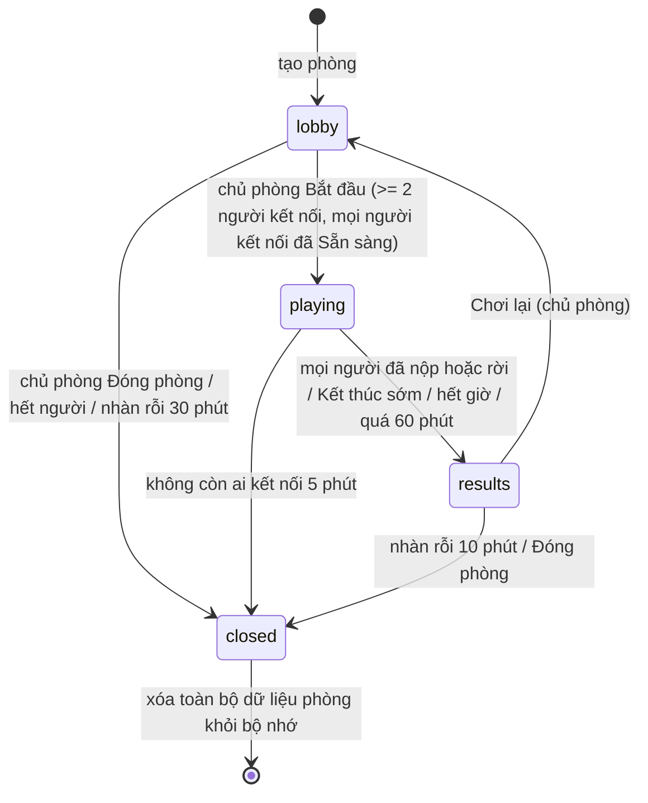

# Luyện tập nhóm (phòng 1v1 / nhiều người)

> **Trạng thái: thiết kế ĐÃ DUYỆT (chủ, 31/10, D1–D14 theo khuyến nghị — xem [plan §6](group-practice-plan.md#6-quyết-định-của-chủ-sở-hữu)). Lõi phòng (Sprint S1) nằm trong `rooms/`, tắt mặc định bằng `ROOMS_ENABLED`; chưa có UI/SSE/deploy.** Mọi tên người chơi, điểm, mã phòng trong tài liệu và ảnh là **dữ liệu mẫu**.
>
> Tài liệu liên quan: thiết kế kỹ thuật + đánh đổi + khuyến nghị: [group-practice-tech.md](group-practice-tech.md) · hợp đồng API/sự kiện: [group-practice-api.md](group-practice-api.md) · kế hoạch triển khai: [group-practice-plan.md](group-practice-plan.md) · ảnh thiết kế: [previews/group-practice/](previews/group-practice/index.html).

## 1. Quyết định của chủ sở hữu (31/10) — đã chốt

1. Học sinh công khai, **không tài khoản**: vào bằng **tên hiển thị + mã phòng hoặc đường dẫn**.
2. Mọi người làm **cùng một đề, cùng lúc**; chủ phòng bấm **Bắt đầu**; **bảng xếp hạng ở cuối**. Không đua tốc độ, không bảng điểm trực tiếp từng câu.
3. Hỗ trợ **1v1** (= phòng 2 người) và phòng nhiều người.
4. Chủ phòng chọn **đề có sẵn** (theo đường dẫn/slug) hoặc **trộn theo loại**: lớp, kỹ năng (`doc-hieu`/`ngu-phap`/`tu-vung`/`viet-cau`), chủ đề, số câu (10/20/40), độ khó — trộn bằng mixer tất định hiện có (`web/lib/mixer`), seed lưu theo phòng.

## 2. Luồng người dùng

```
Trang /luyen-tap-nhom ─┬─ Tạo phòng ─► (chọn đề, cài đặt, tên) ─► Phòng chờ (chủ phòng)
                       └─ Nhập mã / mở link ─► (tên) ─► Phòng chờ (người chơi)
Phòng chờ ─► [mọi người bấm Sẵn sàng] ─► [chủ phòng: Bắt đầu] ─► Làm bài ─► Nộp bài ─► Chờ người khác ─► Kết quả ─► Chơi lại / Phòng mới / Thoát
```

| # | Luồng | Mô tả | Màn hình |
|---|-------|-------|----------|
| 1 | Tạo phòng | Chọn **Đề có sẵn** (dán đường dẫn đề hoặc chọn) hoặc **Trộn theo loại** (lớp, kỹ năng nhiều lựa chọn, chủ đề, 10/20/40 câu, độ khó). Cài đặt: số người tối đa (2 = đấu đôi, 5, 10, 20, 30), giới hạn thời gian (không / 15 phút / 30 phút), tên hiển thị. Server dựng đề, trả mã 6 ký tự. | 01, 02 |
| 2 | Vào phòng | Nhập mã (không phân biệt hoa thường) hoặc mở link `/luyen-tap-nhom/phong/<mã>`; nhập tên; vào phòng chờ. Xem tóm tắt phòng trước khi vào. | 03 |
| 3 | Phòng chờ | Danh sách người chơi (cập nhật tức thời), sao chép mã/đường dẫn, chủ phòng chỉnh cài đặt, đuổi người chơi, bấm Bắt đầu. **Bước Sẵn sàng:** mỗi người (kể cả chủ phòng, không tự động sẵn sàng) bấm "Sẵn sàng" / "Bỏ sẵn sàng"; danh sách hiện chữ "Sẵn sàng" / "Chưa sẵn sàng" và bộ đếm "Đã sẵn sàng 3/4". Nút Bắt đầu chỉ mở khi có ≥ 2 người đang kết nối **và mọi người đang kết nối đều đã sẵn sàng** (lý do hiện dưới nút: "Chờ N người sẵn sàng"). Người mất kết nối/đã rời không chặn. Người mới vào luôn "chưa sẵn sàng"; đổi cài đặt đề/giờ/sĩ số đặt lại mọi người về chưa sẵn sàng (có thông báo); khóa phòng thì không. Mất kết nối > 60 s rồi quay lại: phải bấm lại. Không tự bắt đầu: chủ phòng vẫn bấm Bắt đầu. | 04 |
| 4 | Làm bài | Cùng đề cùng lúc. Mỗi người tự đi qua câu hỏi theo tốc độ của mình, đổi đáp án tự do tới khi nộp. Thấy **chỉ số "Đã nộp: x/y"**, không thấy đáp án/điểm/tiến độ từng câu của ai. | 05 |
| 5 | Nộp bài | Nút Nộp bài (cảnh báo số câu chưa trả lời); nộp rồi không sửa được. | 05 |
| 6 | Chờ người khác | Danh sách chỉ có trạng thái (Đã nộp / Đang làm / Mất kết nối), **chưa hiện điểm** của ai kể cả mình. Chủ phòng có "Kết thúc sớm". | 06 |
| 7 | Kết quả | Khi mọi người đã nộp (hoặc kết thúc sớm / hết giờ): bảng xếp hạng, điểm của mình, xem đáp án + giải thích của mình. | 07 |
| 8 | Chơi lại (rematch) | Chủ phòng bấm "Chơi lại" → cả phòng về phòng chờ, giữ nguyên người còn kết nối; đề mới (trộn: seed mới; đề có sẵn: giữ đề, đổi thứ tự phương án) hoặc chủ phòng đổi đề; mọi người bấm Sẵn sàng lại (về chưa sẵn sàng), rồi chủ phòng bấm Bắt đầu. | 04 |
| 9 | Lỗi/trống | Phòng đầy, không tìm thấy/hết hạn, chủ phòng rời. | 08–10 |

## 3. Trạng thái phòng



Trạng thái của từng người chơi: `joined` (trong phòng chờ) → `playing` → `submitted`; cờ `connected` bật/tắt độc lập; `kicked`/`left` là trạng thái cuối.

## 4. Quy tắc

### 4.1. Số người
- Tối thiểu **2** để bắt đầu (1v1 = `maxPlayers` 2). Tối đa **45** (D11, dùng cho lớp học); chủ phòng chọn mức trần ≤ 45. Trần mặc định 10.
- Phòng đầy: người mới thấy màn "Phòng đã đủ người". Chỗ của người mất kết nối được **giữ** (xem 4.5) nên không bị người mới chiếm trong lúc làm bài.

### 4.2. Vào muộn
- Chỉ vào được khi phòng ở `lobby`. Sau Bắt đầu: "Phòng đã bắt đầu" (không có chế độ xem trộm, không vào giữa chừng) — công bằng với người đã làm. Người **đã ở trong phòng** nhưng rớt mạng thì vào lại bằng token (4.5).
- Sau "Chơi lại" phòng mở lại, người mới vào được nếu còn chỗ.

### 4.3. Chủ phòng
- Người tạo phòng. Quyền: sửa cài đặt (chỉ ở phòng chờ), đuổi người, Bắt đầu, Kết thúc sớm, Chơi lại, Đóng phòng. Chủ phòng cũng làm bài và được xếp hạng như người khác.
- **Chủ phòng bấm "Đóng phòng"** → phòng đóng ngay, mọi người thấy "Phòng đã đóng".
- **Chủ phòng mất kết nối / thoát tab**: chờ 60 giây (banner "Chủ phòng mất kết nối") rồi **chuyển quyền chủ phòng** cho người vào sớm nhất đang kết nối. Trong lúc đó, người chơi vẫn làm và nộp bài bình thường; phòng không bị treo vì chủ phòng. Không còn ai kết nối 5 phút → phòng đóng.
- Phòng đang `playing` kết thúc **không phụ thuộc** chủ phòng (xem 4.4).

### 4.4. Hẹn giờ và khi nào kết thúc
- Cài đặt: **Không giới hạn** hoặc **15 / 30 phút** (đồng hồ chạy theo **giờ server**; client chỉ hiển thị, đồng bộ lệch giờ bằng `serverNow`).
- Hết giờ: server tự nộp các đáp án đã lưu của mọi người chưa nộp (không đáp án = sai) → chuyển sang `results`.
- Phòng không giới hạn: vẫn có **trần cứng 60 phút** kể từ lúc bắt đầu để không treo tài nguyên.
- Kết thúc sớm khi: tất cả người **đang kết nối** đã nộp (người mất kết nối quá **2 phút** trong lúc làm bị tính "đã rời", tự nộp phần đã làm, không chặn phòng) hoặc chủ phòng bấm **Kết thúc sớm**.
- Đáp án được lưu lên server mỗi lần chọn (debounce ~300 ms) nên rớt mạng/đóng tab không mất bài.

### 4.5. Mất kết nối và vào lại
- Mất kết nối: đánh dấu "Mất kết nối", giữ chỗ và đáp án. Vào lại (cùng trình duyệt, token còn trong bộ nhớ trình duyệt) → server gửi ảnh chụp trạng thái đầy đủ, người chơi tiếp tục đúng chỗ. Kỹ thuật: [group-practice-tech.md §5](group-practice-tech.md#5-token-vào-lại-và-phiên).
- Mất token (xóa dữ liệu trình duyệt, đổi máy): coi như người mới; ở phòng chờ vào lại bằng mã; đang làm bài thì **không** vào lại được (chỗ cũ vẫn thuộc về token cũ).
- Bị chủ phòng đuổi: token bị chặn trong phòng này; có thể vào lại ở phòng chờ bằng token mới trừ khi chủ phòng bật "Khóa phòng".

### 4.6. Ai thấy gì, khi nào
| Thông tin | Trước khi nộp | Sau khi mình nộp | Kết quả (`results`) |
|-----------|---------------|------------------|----------------------|
| Câu hỏi, bài đọc, phương án | có (không kèm đáp án đúng) | — | có |
| Đáp án đúng, giải thích | **không** | **không** (còn người đang làm → tránh nhắn đáp án cho nhau) | có (của chính mình + mọi câu của đề) |
| Điểm của mình | không | không | có |
| Số người đã nộp (x/y) | có | có | — |
| Tên + trạng thái (Đã nộp/Đang làm/Mất kết nối) | có | có | — |
| Đáp án đã chọn, điểm, tiến độ câu của người khác | **không bao giờ** | không bao giờ | bảng xếp hạng: tên + số câu đúng; không hiện đáp án từng câu của người khác |

> Chặt hơn yêu cầu gốc ("khóa đáp án tới khi người chơi nộp bài"): đáp án chỉ lộ khi cả phòng đã xong, để người nộp sớm không chuyển đáp án cho người còn đang làm trong cùng lớp.

### 4.7. Chấm điểm và xếp hạng
- **Điểm = số câu đúng** (mỗi câu 1 điểm; không chọn = sai; không trừ điểm câu sai). Tính phía server.
- Xếp hạng theo điểm giảm dần. **Hòa điểm = cùng hạng** (kiểu 1, 1, 3). Trong cùng hạng thứ tự hiển thị theo **thứ tự vào phòng** (trung tính, không dựa tốc độ làm bài — đúng yêu cầu "không đua tốc độ"). Thời gian nộp **không** dùng để xếp hạng.
- Hiển thị: hạng, tên, `đúng/tổng`, phần trăm. Không có điểm âm, không điểm thưởng.
- Người bị đuổi hoặc rời trước khi nộp bài trong lúc `playing` không xuất hiện trong bảng.

### 4.8. Chơi 1v1 (đấu đôi)
- Chọn "2 người" (đấu đôi) khi tạo: mã/link gửi cho 1 bạn, người thứ hai vào là đủ phòng; nút Bắt đầu mở khi đủ 2 người.
- Phòng chờ rút gọn (chỉ 2 ô người chơi).
- Kết quả hiển thị kiểu đối đầu: **Thắng / Hòa / Thua** + số câu đúng hai bên; sau khi cả hai xem đáp án có thể xem "câu hai bạn khác nhau" (chỉ số câu, không lộ thêm).
- Một người rời giữa chừng: người còn lại vẫn nộp bài, kết quả hiển thị "Bạn ấy đã rời" và tính thắng cho người còn lại nếu người kia rời trước khi nộp (cài đặt mặc định; xem quyết định D7).
- Chơi lại: cùng quy tắc chung.

### 4.9. Nội dung và an toàn
- **Không chat tự do**, không emoji reaction nhập tay, không gửi tin giữa người chơi, không ảnh đại diện tải lên. Chỉ có tên hiển thị.
- Tên hiển thị 2–20 ký tự, lọc từ cấm, không số điện thoại/link/tài khoản mạng xã hội ([tech §7](group-practice-tech.md#7-lạm-dụng-và-bảo-vệ-trẻ-em)).
- Không thu thập email, họ tên thật, số điện thoại, vị trí.

## 5. Quyền riêng tư (Luật 91/2025/QH15, NĐ 356/2025/NĐ-CP) — tóm tắt
- Không tài khoản, không cookie theo dõi; chỉ có token vào lại gắn với một phòng, lưu trong trình duyệt của người chơi, xóa khi phòng kết thúc.
- Dữ liệu duy nhất do người chơi nhập: **tên hiển thị tạm**; đáp án đã chọn. Chỉ nằm trong **bộ nhớ** tiến trình, **không ghi cơ sở dữ liệu**, xóa khi phòng đóng (tối đa ~3 giờ kể cả trường hợp xấu nhất; thường 10–30 phút sau khi xong).
- Log không chứa tên, đáp án; IP chỉ dạng băm có salt xoay theo ngày.
- Chỉ số tổng hợp ẩn danh (số phòng/ngày, kích thước phòng, điểm trung bình) được phép, không gắn tên.
- Không quảng cáo trong bất kỳ trang phòng nào (landing `/luyen-tap-nhom` được phép có quảng cáo trẻ em/không cá nhân hóa như các trang khác). Chi tiết: [tech §7–8](group-practice-tech.md#8-quyền-riêng-tư-và-lưu-giữ-dữ-liệu).
- Mục "Luyện tập nhóm" của Chính sách quyền riêng tư đã có trong bản nháp (hiện khi bật `ACCOUNTS_ENABLED`, [user-accounts.md](user-accounts.md) mục 7.1); cần luật sư duyệt trước khi mở.

## 6. SEO
- `/luyen-tap-nhom`: trang tĩnh, **index**, có `title`/`description`/canonical/OG, `BreadcrumbList` + `FAQPage` (cách chơi, miễn phí, không cần tài khoản, an toàn cho học sinh), liên kết từ trang chủ, trang lớp và footer; có trong sitemap.
- `/luyen-tap-nhom/phong/<mã>` (mọi trang phòng): `noindex, nofollow` bằng meta **và** header `X-Robots-Tag`, `Referrer-Policy: no-referrer`, **không** có trong sitemap, không liên kết nội bộ. Không chặn bằng `robots.txt` (để bot đọc được `noindex`).
- Không tạo trang tĩnh theo từng phòng; route phòng là vỏ client-render.

## 7. Thiết kế giao diện
- 10 màn × 2 kích thước (1440 / 390): xem [previews/group-practice/index.html](previews/group-practice/index.html), ảnh PNG trong `previews/group-practice/png/`, brief ở [BRIEF.md](previews/group-practice/BRIEF.md).
- Thương hiệu **BeeJunior** (logo ong + bảng màu vàng `#ffc001` / xanh da trời `#10b7eb` / mực `#291e1c`, dùng sắc độ đạt tương phản: nút chính nền vàng chữ mực; liên kết/chọn dùng xanh đậm `#0a6f96`), Be Vietnam Pro cục bộ, mục tiêu chạm ≥ 44px, focus rõ, tương phản ≥ 4.5:1, tôn trọng `prefers-reduced-motion`. Thay hướng cam/navy tạm thời theo chỉ đạo của chủ 31/10.
- Màn làm bài: **không quảng cáo**, không điểm/đáp án người khác.
- Ảnh là bản xem trước tĩnh với dữ liệu mẫu, không phải mã sản xuất; cần chủ duyệt thẩm mỹ trước khi hiện thực.

## 8. Câu hỏi cần chủ quyết định
Xem [group-practice-plan.md §6](group-practice-plan.md#6-quyết-định-cần-chủ-sở-hữu).
